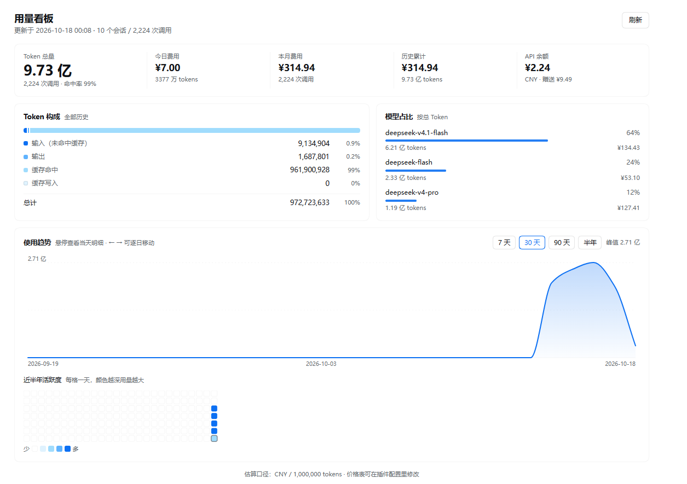

# DSH Usage Dashboard · dsh-usage-dashboard

A desktop dashboard for DeepSeek Harness. One sidebar icon opens a full page of token usage, cost estimation, account balance, usage trends, and model share — every number derived live from your own session logs.



## What it shows

| Area | Content |
|---|---|
| **Readout strip** | Total tokens (with call count and cache-hit rate), today's cost, this month's cost, all-time cost, API balance (recharge wallets + bonus; renders `signed out` instead of an error) |
| **Token composition** | Stacked proportion bar plus a table of input (uncached) / output / cache hit / cache write with counts and shares, and the cache-hit rate |
| **Model share** | Top models by total tokens with share bars, token counts and per-model cost; the same model served by several providers is merged into one row, with the provider list on hover |
| **Usage trend** | Smooth line (monotone cubic — a zero-usage day can never be drawn below the baseline) with a hover crosshair and a per-day card; 7 / 30 / 90 / 182-day ranges, `←` `→` to step |
| **Activity heatmap** | One cell per day over the last six months, darker means more usage; hovering rings the cell and reports that day in the legend row, so the floating card never covers the grid |

Chart and heatmap share the DeepSeek blue ramp `#dff2fe → #a0dcfd → #60b3fe → #0c70f3`. Everything structural uses host theme tokens (`--dsw-alias-*`), so light and dark themes follow the shell.

## Install

### What you get after installing

- A bar-chart icon in the sidebar, just above Settings
- Clicking it swaps the centre column for the dashboard
- The plugin manager lists it as "Usage Dashboard" with its own icon

### Requirements

- DeepSeek Harness Desktop 0.2.x
- Node.js `>= 20`

### Option 1 — install from a local directory (recommended, edits apply immediately)

```bash
git clone https://github.com/JeffKeeping/dsh-usage-dashboard.git
```

Then, inside Harness (use your real clone path):

```
plugin_manager action=install_bundle target=<absolute-path>/dsh-usage-dashboard
```

or from the CLI:

```bash
dsh plugin install <absolute-path>/dsh-usage-dashboard
```

The bundle applies immediately. If the sidebar icon does not appear, refresh the window once with `Ctrl+R` — client code is loaded as modules, so a refresh is what picks up the newest file on disk.

### Option 2 — install from npm

```bash
dsh plugin install dsh-usage-dashboard
```

### Verify

```bash
curl http://127.0.0.1:<your-port>/dsh-usage-dashboard/snapshot
```

`{"ok":true,...}` means the Host half is live. The first open scans every session log (a second or two); afterwards a revision cache re-reads only changed sessions (measured: ~800 ms cold, ~25 ms warm).

## Configuration

The price table lives in `cordis.patch.yml`, and is also editable from the plugin manager page:

```yaml
- insert:
    - id: dsh-usage-dashboard
      name: dsh-usage-dashboard
      config:
        historyDays: 182      # daily series + heatmap window (the line slices it)
        maxSessions: 600      # newest N session logs are scanned
        pricing:
          currency: CNY
          unit: 1000000       # prices are per this many tokens
          default: { miss: 2, hit: 0.2, write: 2, output: 3 }
          models:
            deepseek-v4.1-flash: { miss: 2, hit: 0.2, write: 2, output: 3 }
            deepseek-v4-pro: { miss: 4, hit: 1, write: 4, output: 12 }
```

- Model keys match a model id exactly first, then by **longest prefix** (`deepseek-v4-pro` also covers `deepseek-v4-pro-2026`); anything unmatched falls back to `default`
- Cost formula: `(miss × input + hit × cacheRead + write × cacheWrite + output × output) / unit`

> ⚠️ The shipped numbers are a **starting point for estimation**, not a billing statement. Replace them with the prices you actually pay. The dashboard footer always states the currency and unit in effect.

### Counter semantics

`TokenUsage` in the session log follows Anthropic Messages semantics (the DeepSeek route speaks that protocol):

- `inputTokens` is the **non-cached** prompt
- `cacheReadTokens` / `cacheWriteTokens` are **additive, separate** counters — not a subset of `inputTokens`
- `prompt = input + cacheRead + cacheWrite`, `tokens = prompt + output`

## How it works

Every number is derived from the session log; the plugin owns no source of truth:

```
assistant/message ─┬─ data.usage          → the four token counters
                   └─ data.message.source → provider + model
```

- The Host half reads logs through `sessionPersistence` and caches per session keyed by `SessionPersistenceSnapshot.revision` (the cache lives on a `Symbol.for` global, so an HMR remount does not rescan everything)
- One read-only route: `GET /dsh-usage-dashboard/snapshot[?refresh=1]`, `no-store`
- The Client half only renders; it polls the snapshot every 60 s, and a manual refresh also re-reads the account balance

## Uninstall

```
plugin_manager action=remove_bundle target=dsh-usage-dashboard
```

## Known limits

- Counts only sessions visible to this process via `sessionPersistence.list()`, capped by `maxSessions`
- Balance needs the Host `deepseekAccount` service; without it the card says "unavailable" instead of failing
- Sessions archived off by another tool are not counted

## License

MIT
